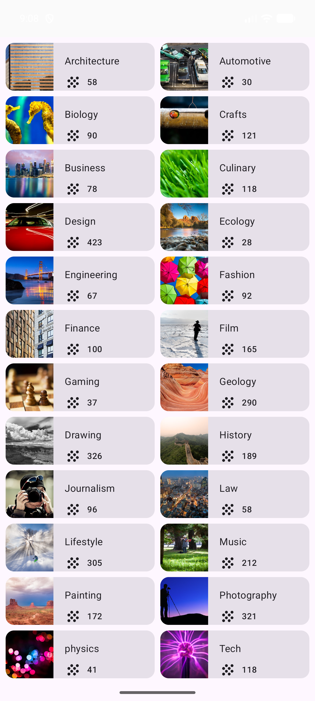
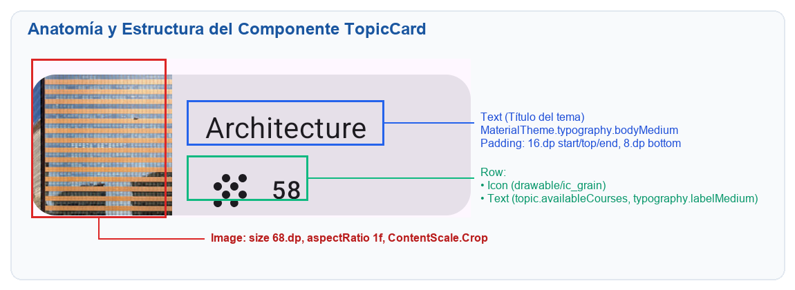

# Courses App - Práctica de Cuadrícula con Jetpack Compose 📱✨

[](https://developer.android.com/)
[](https://kotlinlang.org/)
[](https://developer.android.com/jetpack/compose)
[](https://developer.android.com/)
[](https://developer.android.com/)

Proyecto y solución completa para el Codelab oficial de Google:  
👉 **[Android Basics with Compose: Práctica: Crea una cuadrícula (Build a Grid)](https://developer.android.com/codelabs/basic-android-kotlin-compose-practice-grid?hl=es-419)**

---

## 📸 Capturas de Pantalla

| Vista Inicial (Parte Superior) | Vista con Desplazamiento (Scroll) |
| :---: | :---: |
|  |  |

---

## 🧩 Anatomía del Componente `TopicCard`

Cada tarjeta organiza de manera declarativa la fotografía del curso y sus metadatos (título, ícono de grano y contador de cursos disponibles):

<p align="center">
  
</p>

---

## 🛠️ Tecnologías y Características Implementadas

* **`LazyVerticalGrid`**: Cuadrícula perezosa con 2 columnas fijas (`GridCells.Fixed(2)`), optimizada con reciclaje de memoria para desplazamientos a 60/120 FPS.
* **Componentes Atómicos**: Uso de `Card`, `Row`, `Column`, `Box`, `Image` y `Icon` para componer `TopicCard`.
* **Escalado Preciso de Multimedia**: Dimensiones fijas de 68 dp x 68 dp con `aspectRatio(1f)` y `ContentScale.Crop`.
* **Tipografía y Estilos Material 3**: `bodyMedium` para títulos y `labelMedium` para los contadores.
* **Manejo Seguro de Recursos**: Anotaciones `@StringRes` y `@DrawableRes` en el modelo de datos `Topic`.
* **Diseño Edge-to-Edge**: Integración de `enableEdgeToEdge()` y `statusBarsPadding()`.
* **Solución de Incidencias**: Incorporación del vector drawable `ic_grain.xml` (recurso con enlace caído en el codelab original).

---

## 📁 Estructura del Proyecto

```text
Courses/
├── app/src/main/
│   ├── java/com/example/courses/
│   │   ├── MainActivity.kt        // Actividad principal y composables (TopicCard, TopicGrid)
│   │   ├── model/
│   │   │   └── Topic.kt           // Data class representativa del modelo de datos
│   │   ├── data/
│   │   │   └── DataSource.kt      // Repositorio con los 24 temas disponibles
│   │   └── ui/theme/              // Tema Material 3, colores y tipografía
│   └── res/
│       ├── drawable/              // 24 imágenes temáticas (.jpg/.jpeg) + ic_grain.xml
│       └── values/
│           ├── strings.xml        // Strings localizados de los temas
│           └── dimens.xml         // Dimensiones estandarizadas (padding_small, padding_medium)
├── screenshots/                   // Evidencias visuales y diagramas
└── Informe_Practica_Cuadricula_Compose.docx // Informe completo de la práctica en Word
```

---

## 📄 Informe en Formato Word

El informe de laboratorio detallado con explicaciones paso a paso, análisis técnico y capturas integradas se encuentra disponible en este repositorio:
* 📑 **[`Informe_Practica_Cuadricula_Compose.docx`](Informe_Practica_Cuadricula_Compose.docx)**

---

## 🚀 Cómo Ejecutar el Proyecto

1. Clona el repositorio:
   ```bash
   git clone https://github.com/JhonnyCCM/Jetpack-Compose-Courses-App-.git
   ```
2. Ábrelo en **Android Studio** (versión Ladybug o superior).
3. Sincroniza las dependencias de Gradle.
4. Ejecuta la aplicación en un emulador o dispositivo físico con Android 7.0+ (API 24+).
